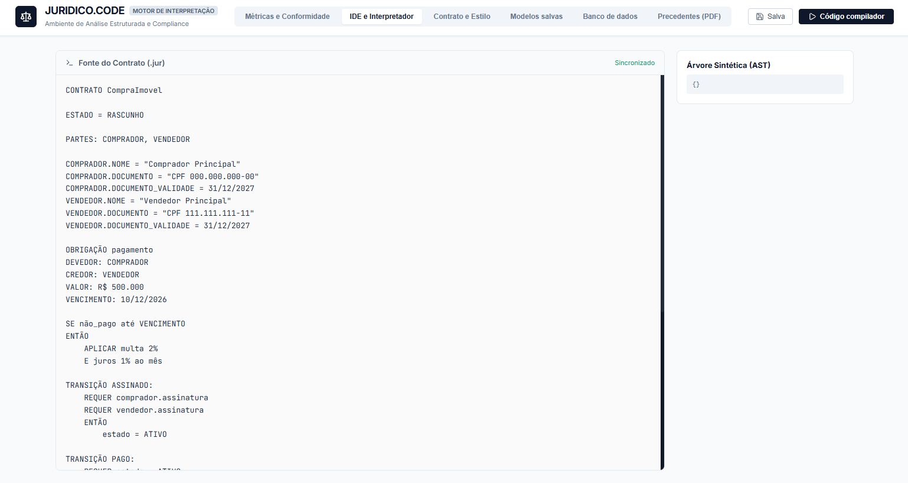
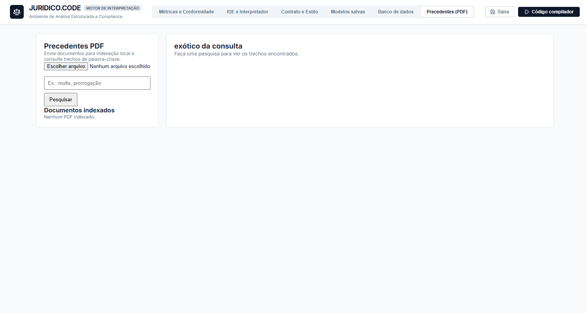

# Juridico.Code

> **The "COBOL of Law": A collaborative, auditable, and deterministic domain-specific language powered by Finite State Machines (FSM) for legal contracts.**

---

Traditional legal contracts written as static text are prone to ambiguities, logical contradictions, untracked defaults, and a lack of operational determinism. **Juridico.Code** bridges this gap by introducing a declarative domain-specific language (`.jur`), a static legal/financial compliance engine, and an interactive environment (CLI + Web Dashboard) to simulate state transitions, audit contract clauses, and cryptographically certify legal documents.

---

## 🌐 Languages

- [English](README_en.md)
- [Português (Brasil)](../../README.md)

---

## 🏷️ Badges

[](https://github.com/Juridicode/Juridicode/releases)
[](../../LICENSE)
[](https://www.python.org/)
[](https://fastapi.tiangolo.com/)
[](https://react.dev/)

---

## 🧭 Navigation

- [Quick start](#-quick-start)
- [How it works](#-how-it-works)
- [Features](#-features)
- [Visual Interface & Screenshots](#-visual-interface--screenshots)
- [Showcases](#-showcases)
- [FAQ](#-faq)
- [Documentation](#-documentation)

---

## 🚀 Quick start

### Prerequisites
- **Python**: `>= 3.10`
- **Node.js**: `>= 18.x` (for the web visualizer)
- **Git** and Windows environment (or bash/cmd compatible terminal)

### Installation
Clone the repository, install dependencies, and register the `juris` global command:

```bash
git clone https://github.com/Juridicode/Juridicode.git
cd Juridicode
pip install -r requirements.txt
python build_installer.py
```
*(On Windows, you can also run `Instalar.bat` or the graphical installer via `python installer_gui.py`)*

### Usage Example
> **What is the primary task you want to automate or investigate?**  
> *Parse, validate legal/logical contradictions, and inspect the Finite State Machine transitions of a real estate sale agreement.*

```bash
juris examples/compra_imovel.jur
```

---

## ⚙️ How it works

1. **Lexical and Syntactic Analysis (`Lexer` & `Parser`)**: The `.jur` code is converted into an Abstract Syntax Tree (AST), checking grammar and legal syntax rules.
2. **Semantic and Anti-Contradiction Engine (`Evaluator`)**: Validates financial consistency and legal rules (such as Art. 381 of the Civil Code prohibiting confusion between creditor and debtor).
3. **Finite State Machine (FSM)**: Enforces contract lifecycles (`RASCUNHO`, `ATIVO`, `FINALIZADO`, `VENCIDO`) based on verified prerequisites and signatures.
4. **Interactive Dashboard**: The CLI boots the FastAPI backend and launches the browser to view the contract dashboard, test real-time conditions, and export certified signed documents.

---

## 📋 Features

| Target / Component | Output | Requirements |
| :--- | :--- | :--- |
| **Legal Interpreter Engine** | Lexer, Parser with AST generation and legal type evaluation | Python 3.10+ |
| **Contradiction Detector** | Static warnings and blocks for legal conflicts (e.g. debtor == creditor) | Python runtime, Civil Code rule checks |
| **Contract FSM** | Deterministic lifecycle execution governed by transitions and requirements | `.jur` contracts declaring `TRANSIÇÃO` and `REQUER` |
| **Backend Services** | REST API for compilation, dynamic clause checks, and PDF certification | FastAPI, Uvicorn, ReportLab |
| **Global CLI (`juris`)** | Single command to parse files and launch the visual web dashboard | Windows PATH / shell environment |
| **Interactive Web UI** | Real-time state simulator, code editor (REPL), and audit trail dashboard | React, Vite, Node.js 18+ |

---

## 🖼️ Visual Interface & Screenshots

Real screenshots showcasing the workflows within the **Juridico.Code** environment:

### 1. Terminal Startup via Global CLI
Running `juris` performs tokenization, AST generation, and anti-contradiction audits before opening the dashboard.


### 2. Main Dashboard & Contract Overview
Interactive overview including state metrics, active contract parties, and FSM transition indicators.


### 3. Legal Code Editor & REPL
Integrated `.jur` code editor with syntax checks, execution output, and quick-action toolbars.


### 4. Contract Formatting & Certification
Custom visual themes, header/footer configuration, watermarking, and digital signing parameters.


### 5. Saved Contract Templates
Browse and launch predefined legal templates from the local database.


### 6. Document Database & Audit Trail
Indexed archive of past contracts with SHA-256 verification and audit status tracking.


### 7. Legal Precedents & Knowledge Base
Contextual legal references and statutes attached to clauses and obligations.


---

## 💡 Showcases

- **Deterministic Real Estate Contract**: Down payment, monthly installments, late penalty rules, and automated status transitions.  
  *Reference:* [`examples/compra_imovel.jur`](../../examples/compra_imovel.jur)
- **Legal Conflict & Nullity Detection**: Static detection and blocking of prohibited or contradictory contractual clauses.  
  *Reference:* [`examples/contrato_com_contradicao.jur`](../../examples/contrato_com_contradicao.jur)
- **Service Agreement Workflow**: Stage-based payments and milestone-driven completions.  
  *Reference:* [`examples/prestacao_servicos.jur`](../../examples/prestacao_servicos.jur)

---

## ❓ FAQ

**1. Which platforms are supported?**  
The core Python engine and FastAPI backend are cross-platform (Windows, Linux, macOS). The automated PATH installer scripts (`.bat` / `.cmd`) are natively tuned for Windows.

**2. What happens when a legal contradiction is detected?**  
The engine halts compilation with a diagnostic message detailing the conflicting clauses, parties, or statutory legal provisions violated.

**3. How do I report a bug or contribute?**  
Open an issue or submit a pull request on GitHub following standard contribution practices and maintaining test coverage for the AST parser and evaluator.

---

## 📚 Documentation

- [Language Specification & Manual (Portuguese)](../../MANUAL_DA_LINGUAGEM.md)
- [CLI Reference](cli.py)
- [Visual Installer Guide](installer_gui.py)
- [Example Contracts](../../examples/compra_imovel.jur)

